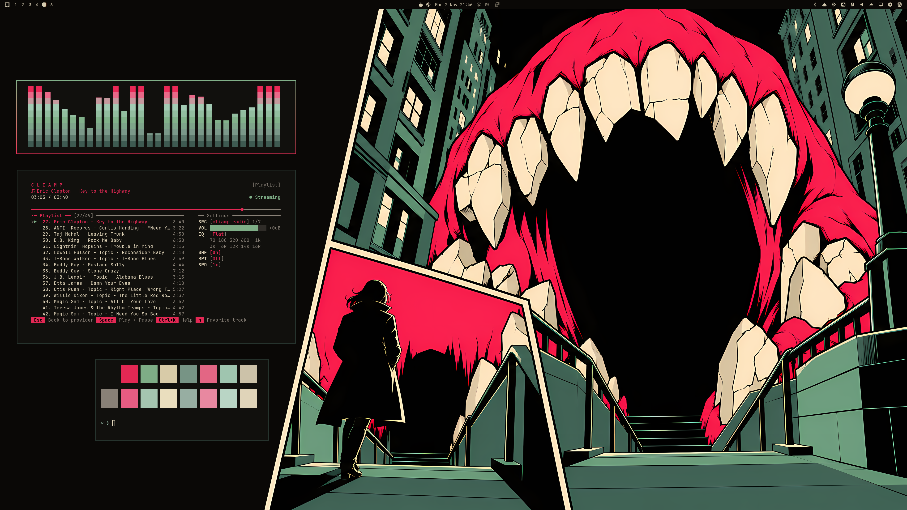
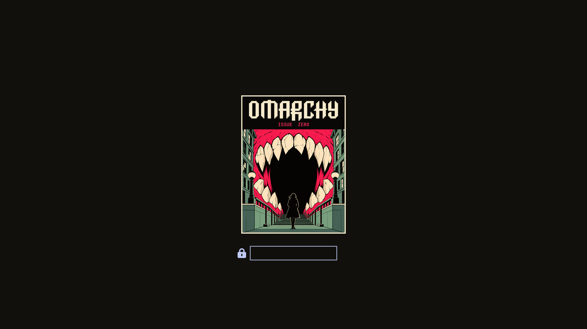
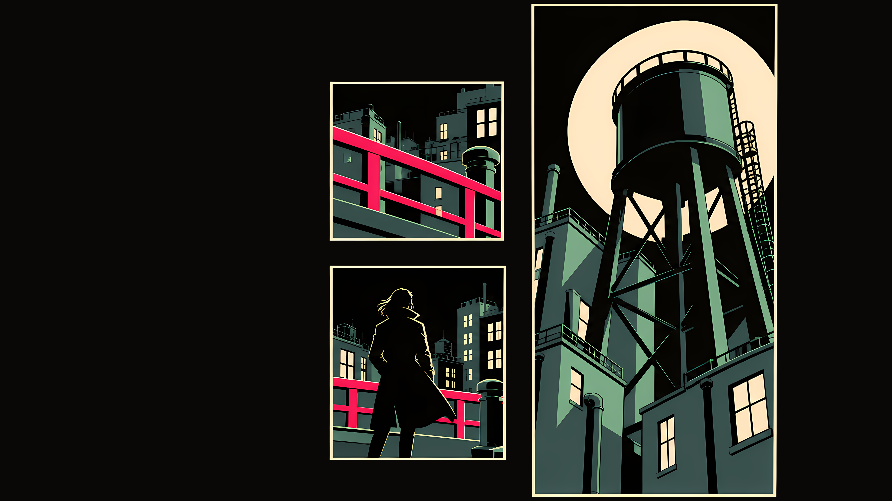
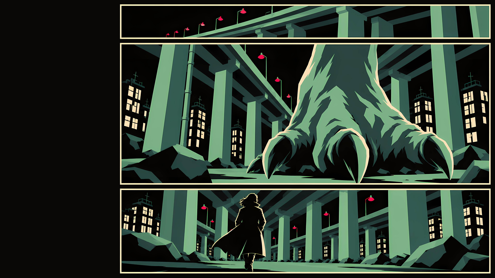
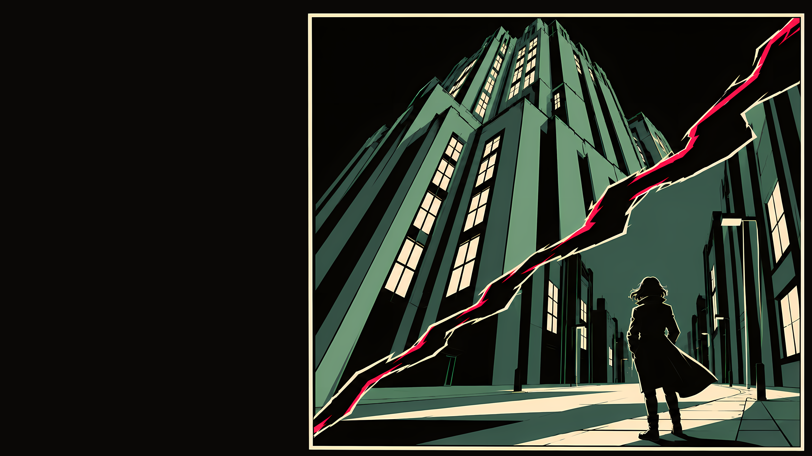
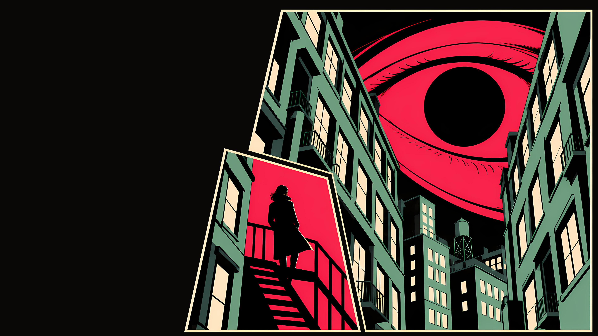
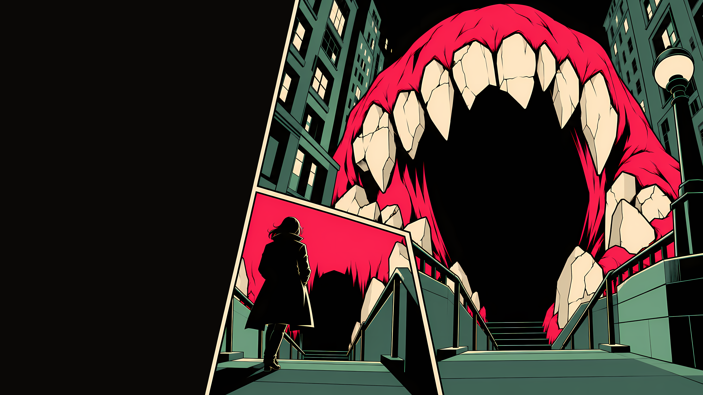
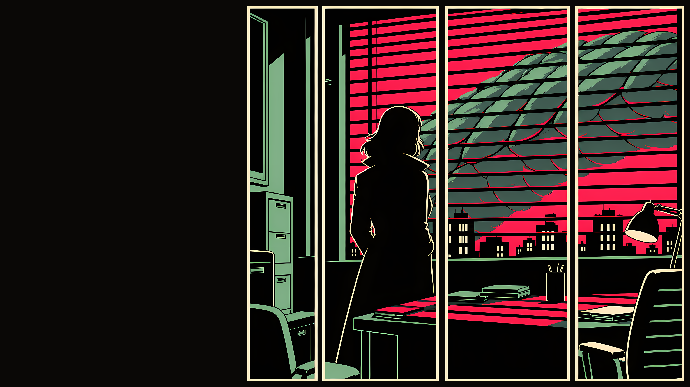
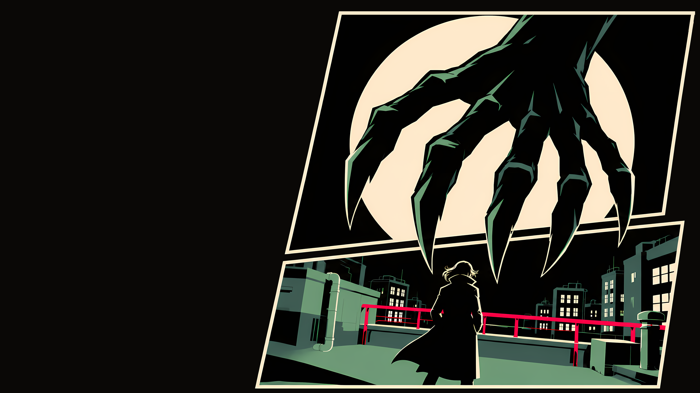

# Issue Zero Omarchy Theme

A comic-book Omarchy theme about a city where something enormous has started turning up at night. Every wallpaper is a page of the same issue: a lone figure in a long coat, a monster too big to fit in the panel, and a black page around it all. The screen is built the same way, with warm black and cream paper as the page, sage for the city, and one hot pink for what needs your attention.

## Preview





## Install

```bash
omarchy theme install https://github.com/Devis99/omarchy-issue-zero-theme
```

## What's Included

- Core Omarchy colours, a sage-to-pink window border and a matching bar, menu, launcher and popups.
- App themes for Discord (Vencord), GTK, Zen, Zed, btop, cava and cliamp, plus Yaru-sage icons.
- A comic-cover Plymouth unlock image and a 7-wallpaper set in `backgrounds/`.
- The palette as a Base24 scheme in `issue-zero-base24.yaml`.

## Palette

The palette is sage greens, warm blacks and cream paper, with hot pink as the loudest colour. The sage greens take their shade from the finished wallpapers, a notch stronger so they hold up next to the pink. There are no blues or purples: the terminal colours are one family of sages, creams and pinks, separated by lightness.

It is a dark theme with soft text and very few colours. Text sits below the usual brightness on purpose, so the page stays comfortable at night and the pink keeps its punch.

## Wallpapers

All wallpapers are 3840x2160, generated with AI (Codex image generation) in a flat inked comic style and upscaled. The theme is released under the MIT License. Scene notes are in `backgrounds/SOURCES.md`.

<table>
  <tr>
    <td><br><sub>01 Tower</sub></td>
    <td><br><sub>02 Overpass</sub></td>
    <td><br><sub>03 Crack</sub></td>
  </tr>
  <tr>
    <td><br><sub>04 Eye</sub></td>
    <td><br><sub>05 Mouth</sub></td>
    <td><br><sub>06 Blinds</sub></td>
  </tr>
  <tr>
    <td><br><sub>07 Hand</sub></td>
    <td></td>
    <td></td>
  </tr>
</table>
